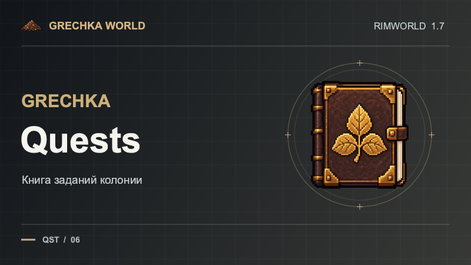

# Grechka World

**Гречка** — набор модов и профиль сборки для RimWorld 1.7: от книги квестов и автоматизированного склада до пятиуровневой промышленности, дронов и охоты за сокровищами.



Модули можно сочетать в собственной сборке. У каждого есть свой `About/About.xml` с зависимостями и порядком загрузки; правила и баланс всей сборки вынесены в Grechka World Integration.

## Моды

| Мод | Что добавляет |
| --- | --- |
| [Quests](mods/GrechkaQuests) | Книгу квестов, редактор и импорт/экспорт JSON. Квесты не забирают предметы. |
| [Storage](mods/GrechkaStorage) | Складскую сеть, диски, кварц и автокрафт на соседних станках. |
| [Industry](mods/GrechkaIndustry) | Промышленные цепочки T1–T5, мехапонику, материю и солнечную энергетику. |
| [Drones](mods/GrechkaDrones) | Спасательных, боевых и караванных дронов для Misc. Robots. |
| [Equipment](mods/GrechkaEquipment) | Броню, оружие, бионику и чипы. |
| [Lucky Blocks](mods/GrechkaLuckyBlocks) | Открываемые блоки с тематическими наградами и настраиваемыми пулами. |
| [Pharmacy](mods/GrechkaPharmacy) | Препараты и фармацевтические реакторы. |
| [Treasures](mods/GrechkaTreasures) | Драгоценные камни, ювелирное дело и поиски сокровищ. |
| [Factions](mods/GrechkaFactions) | Пять фракций со своими бойцами, торговцами и поселениями. |
| [Traders](mods/GrechkaTraders) | Тематических торговцев и настройки частоты прибытия. |
| [Farms](mods/GrechkaFarms) | Настраиваемое плодородное покрытие для посевов. |
| [Tweaks](mods/GrechkaTweaks) | Изменения навыков, интересов, стопок и глушитель звука. |
| [Achivements](mods/GrechkaAchivements) | Достижения для Vanilla Achievements Expanded. |
| [Camera Plus](mods/GrechkaCameraPlus), [Speed Plus](mods/GrechkaSpeedPlus) | Настраиваемый масштаб камеры и четвёртую скорость игры. |
| [Destroy Item](mods/GrechkaDestroyItem), [Kite](mods/GrechkaKite) | Приказ на уничтожение предметов и стрельбу при движении. |
| [Real Ruins and Robots++ Fix](mods/GrechkaRealRuinsRobotsFix) | Исправление зависания генерации при выборе неподходящих роботов в охрану руин. |
| [World Integration](mods/GrechkaWorldIntegration) | Исследования, баланс и интеграции сборки Grechka World. |
| [Translations Rus](mods/GrechkaTranslationsRus) | Локальный адаптер русских переводов; сторонние каталоги переводов в репозиторий не входят. |

## Установка

Готовые архивы модов предназначены для раздела [Releases](https://github.com/nikitakashin/syamich-grechka-mod/releases). Выберите нужный мод и версию для RimWorld 1.7, распакуйте папку мода в `RimWorld/Mods`, установите зависимости из его `About/About.xml` и включите моды в игре. Большинству модулей нужен [Harmony](https://steamcommunity.com/sharedfiles/filedetails/?id=2009463077); некоторым нужны другие моды Grechka или Workshop-моды.

Файлы профиля в [`profiles/GrechkaWorld`](profiles/GrechkaWorld) описывают порядок модов сборки, но не содержат сторонние моды. Проверьте зависимости перед применением профиля. Перед изменениями состава модов в существующем прохождении сохраните резервную копию.

Исходный код из репозитория сам по себе не является готовой установкой: игровые сборки DLL в Git не хранятся. Если подходящего архива в Releases пока нет, мод нужно собрать из исходников.

## Сборка из исходников

Нужны .NET SDK 10, Python 3, установленные библиотеки RimWorld 1.7, Harmony, Misc. Robots и Vanilla Achievements Expanded. Задайте пути к локальным файлам и запустите сборку:

```bash
export RIMWORLD_MANAGED_DIR="/путь/к/библиотекам/RimWorld"
export HARMONY_ASSEMBLY="/путь/к/0Harmony.dll"
export MISC_ROBOTS_ASSEMBLY="/путь/к/AIRobot.dll"
export ACHIEVEMENTS_ASSEMBLY="/путь/к/AchievementsExpanded.dll"
./scripts/build.sh
```

На macOS библиотеки игры находятся в `RimWorld.app/Contents/MacOS`. При необходимости путь к исполняемому файлу .NET задаётся переменной `DOTNET`. Скрипт [`scripts/package.py`](scripts/package.py) создаёт локальные архивы после сборки; игровые DLL и сторонние моды в них не включаются.

Для проверок конфигурации и отдельных компонентов используйте `./scripts/test.sh`, а для изолированных проверок с установленными игровыми библиотеками — `./scripts/test-native.sh`. Для последнего нужны те же переменные окружения; дополнительные интеграции могут требовать других библиотек.

## Состояние проекта

Проект активно развивается. Сборка и изолированные проверки не заменяют испытание в игре: совместимость модов, баланс и поведение в существующих сохранениях могут требовать дополнительной проверки. У отдельных модулей свой номер версии и набор зависимостей.

## Структура

- [`mods/`](mods) — исходники и игровые ресурсы модулей.
- [`profiles/`](profiles) — состав и порядок загрузки Grechka World.
- [`scripts/`](scripts) — сборка, упаковка и проверки.
- [`tests/`](tests) — автоматические проверки.
